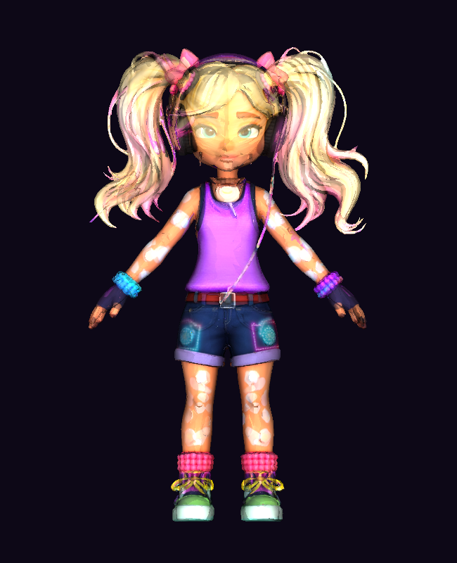
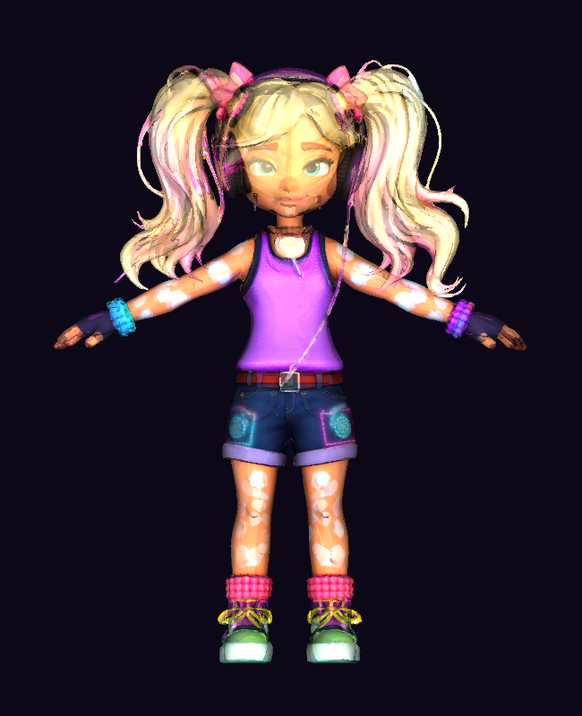

# Kandi Boom — verified source FBX audit

**Character:** Kandi Boom, from *Bass Ben & Friends*.

**Scope:** Phase 1 source-asset acceptance. This is not proof of production
Three.js/PBR rendering, Rigify compatibility, beat-matched capture or retargeting.
The original FBX and supplied four texture maps are preserved byte-for-byte.

## Findings

| Inspection | Verified result |
| --- | --- |
| Format | Binary FBX 7400, Blender FBX export |
| Mesh | 1 mesh, **14,950** control points, **29,965** triangles |
| Rig | **24** `LimbNode` bones; separate Armature parent |
| Bind pose | 26 objects with matrices: 24 bones + mesh + armature |
| Skinning | 1 skin and **24** clusters; **22** carry weighted influences |
| Empty influence clusters | `head_end`, `headfront` (valid leaf/end markers) |
| Unweighted vertices | **0** |
| Weight-sum deviation | **1.68 × 10⁻⁷** maximum |
| Joint bind consistency | Cluster `TransformLink` equals matching bind-pose matrix; max error 0 |
| Inverse bind consistency | Source cluster `Transform × TransformLink` residual **< 2.7 × 10⁻⁵** |
| Normals | 89,895 corner normals; norm error < 2 × 10⁻⁷ |
| UV data | 26,817 coordinate pairs, 89,895 valid corner indices |
| Materials | 1 assigned material slot; external PBR textures supplied separately |
| Texture maps | Albedo, normal, metallic and roughness: all 2048×2048 RGBA PNG |
| Source axis | Y up, X coordinate axis, Z front; unit scale factor 1 |
| Source bounds | X ±50.8246, Y 0–172, Z ±29.6055 in source FBX units |
| Animation | 1 animation stack, 225 curves, **one key on each curve** |
| Motion capture in FBX | **None: no time-varying curves** |

`harness/kandi-boom/rig-audit.json` is the canonical machine-readable audit.
`harness/kandi-boom/source-rig.json` exports exact bind-pose and inverse-bind
matrices for every bone, its hierarchy, initial FBX local transform values,
cluster reference and a SHA-256 fingerprint. This is a *source rest rig*, not a
published Rigify control profile; phase A2 must define actual channels and
retargeting semantics.

## Known problems to address before production motion playback

1. **More than four influences:** 1,071 mesh vertices have 5–10 influences;
   577 would discard more than 1% of their combined weight if limited to four,
   and one would discard approximately **25.1%**. Do not simply truncate the
   FBX; either preserve all influences with a compatible skinning path or
   simplify and renormalise weights with visual/skin-matrix regression tests.
2. **No recorded motion:** the FBX animation stack contains static single-key
   curves only. The procedural viewer's bounce/sway/groove modes are not
   captured dance recordings. Phase A2/A3 must import separate, attributed
   motion sources and do explicit skeleton retargeting.
3. **Rigify has not been established:** 24 named source deform bones are not
   Rigify's generated animator controls. Use a custom `syn://` source rig type
   until a supported Rigify adapter has been proved.
4. **Material mapping:** the FBX embeds a base-colour video; the normal,
   roughness and metallic PNGs are separate assets. Configure colour space,
   UV orientation and channels for the final Three.js/Blender materials. The
   source audit only proves UV integrity and texture encoding.

## Repeat the audit and keep the report pinned

From repository root, without any third-party Python packages:

```sh
python tools/audit_kandi_boom.py \
  --assets harness/kandi-boom/assets \
  --output harness/kandi-boom/rig-audit.json \
  --source-rig-output harness/kandi-boom/source-rig.json --check
python -m unittest discover -s tests/python -p 'test_kandi_boom_*.py' -v
```

To intentionally regenerate after changing source assets, **omit** `--check`,
review both JSON diffs and document why the model changed before committing.
Do not auto-regenerate source fingerprints in CI; CI should fail on drift.

The optional source reference render uses NumPy and VTK; the primary audit
remains dependency-free:

```sh
python -m pip install numpy vtk
python tools/render_kandi_boom_reference.py --output-dir generated/kandi-qa
```




Those previews use the real source mesh, per-corner UVs and albedo. The posed
reference reconstructs each vertex from weighted `inverse_bind × new_world_bind`
transforms; maximum rest-pose reconstruction error is **3.01 × 10⁻⁵ FBX units**,
and 2,365 weighted vertices move by more than 0.01 units under the test pose.
VTK previews are **not** equivalent to a browser screenshot or full PBR review.

## Browser acceptance

The dedicated `Kandi Boom asset and rig QA` GitHub Actions workflow also
performs a real Chromium smoke test using the repository's locked Three.js
version. It substitutes the import map **only inside a temporary fixture** to
serve JS locally without depending on third-party CDNs. It tests an actual FBX
load, captures idle/groove canvas screenshots, checks a responsive tempo readout,
pause behaviour and runtime errors, and retains the output as a CI artifact.

Run with `npm ci`, `pip install playwright==1.64.0`, and
`python -m playwright install chromium`, followed by:

```sh
python tools/test_kandi_boom_browser.py --output-dir generated/kandi-browser-qa
```

Browser test **implementation is complete**, but a successful main-branch
GitHub Actions run and full PBR visual inspection are required before marking
browser/runtime validation as passed. The main/native mesh-gallery integration
remains scheduled for A2–A4.
