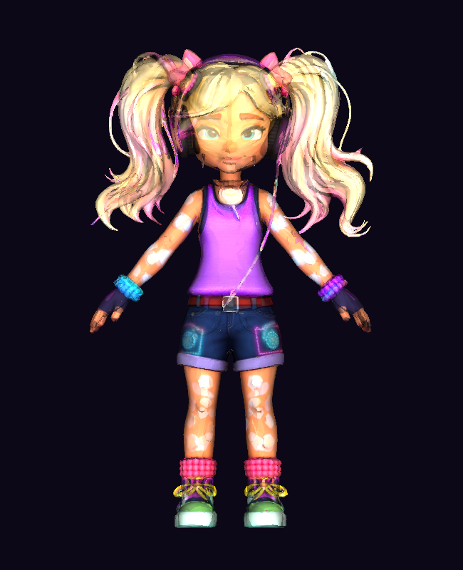

# Python distribution boundaries

The Python wheel supplies the native extension and complete catalogue together
with the authoring APIs, saved profiles, binding examples and illustrated
documentation. C++ consumers use their own native archives or source builds.



*Kandi is a browser/demo target. Her original mesh and textures are separate from
the Python APIs; this image illustrates that distinction and is not a package
installation receipt. A video adds no evidence to this static archive policy.*

| Artifact | Retained | Excluded |
| --- | --- | --- |
| Python wheel | Native Python module, required runtime DLL, authoring modules and full catalogue, profiles, documentation, attribution and examples | C++ headers, static libraries and CMake development configuration |
| Python source archive | C++/Python build inputs, generated catalogue tables, authoring data, source rig metadata, tools, tests and documentation | Generated `harness/index.html`, `harness/beats.json` and `harness/kandi-boom/assets/` mesh/texture payloads |
| Native C++ install | Headers, library and CMake configuration, documentation | No change to the normal complete CMake install |
| Browser demonstration | Its pinned character, textures and explicit motion inputs | No automatic addition to Python distributions |

Scikit-build selects the `Python` and `Documentation` CMake install components.
A normal `cmake --install` without a component still installs the native
Development component. No movement table, saved profile or public sampling API
changes with this split. The source-checkout character workbench and complete
browser tests require the repository/demo assets, rather than the PyPI source
archive alone.

Build a wheel from the actual source archive, not just from a working tree:

```sh
python -m build
python tools/check_package_docs.py --archive dist/*.whl dist/*.tar.gz
python tools/check_pypi_size.py dist
```

Then install the wheel in a new environment and import the native catalogue,
world-motion, loop-repair and loop-review APIs. Verify that the complete 1,731
entry catalogue and the 64-pip wrapping contract remain available. Run the
normal native installed-consumer check to verify that C++ development files
remain in their own distribution.

## Measured release size policy

The full catalogue's reduced Windows CP313 wheel measures 27.91 MiB and its
source archive 35.23 MiB. The former 8/12 MiB thresholds were smaller than the
intrinsic catalogue payload and could not describe a complete current package.
The reviewed policy in `packaging/python-size-budget.json` sets explicit 32 MiB
wheel, 40 MiB sdist and 620 MiB complete-release ceilings. This follows an actual
reduction from 56.50/76.78 MiB; it does not qualify the old duplicated packages.

All release jobs consume that same checked-in policy. Before publishing, the
aggregate gate additionally requires exactly eighteen supported wheels and one
source archive, all named for the exact release version. An incomplete matrix,
foreign version, duplicated ABI/platform pair, wrong architecture, oversized
file or excessive total fails. Compound manylinux tags count as one Linux
identity; a wheel's Python and ABI tags must agree. Archive-content and
native/catalogue checks remain separate and mandatory. A future architecture or
matrix change needs a reviewed policy update rather than an unbounded override.

These local budgets do not grant PyPI storage. A project quota rejection still
requires verified available capacity; retain existing immutable versions and
request an administrator increase when necessary.

## Potential problems

- **A Python wheel contains both a native module and a static C++ library.**
  Selecting every CMake install rule duplicates compiled movement data and ships
  headers to Python consumers. Select the Python/Documentation components and
  inspect the actual wheel; `check_package_docs.py` rejects those development
  payloads if they return.
- **The source archive includes a large generated viewer or character assets.**
  Git-tracked browser payloads can enter the default source file list even when
  build caches are ignored. Exclude the named demo outputs while retaining the
  native rebuild inputs and small saved source rig. The archive checker rejects
  these payloads, and building the wheel from the sdist verifies the retained
  build contract.
- **A reduced archive still fails a size or registry quota gate.** Removing
  duplicate bytes does not establish compliance or restore storage capacity.
  Preserve the measured failure and candidate artifacts. Do not silently raise
  budgets, remove catalogue entries, delete old releases, or claim publication.

Music and project author: [Kieran Simkin](https://kieransimkin.co.uk/my-songs/).
