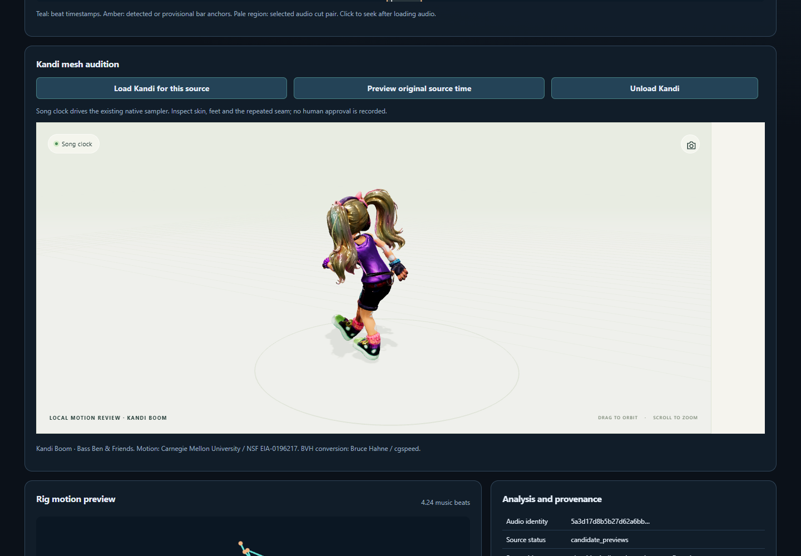

# StemLab songs × source-first motion-loop review

The default is an **audio-free, generated CI review artifact**, not a released motion
package, new pattern catalogue, automatically verified music sync, or public
music redistribution. DanceRudiments does not gain a StemLab runtime dependency.

An explicitly requested private local collection audition can separately include
selected example masters, as described below. Never publish that private bundle.

## Local collection audition

Use the complete index from `analyze_motion_collection.py` to compare reviewed
source recordings with only the StemLab songs you select. Resolve and pin the
latest official StemLab release first, then import that exact checkout's loop
analyser. No new model or download is needed by the preview builder.

```bash
python tools/build_song_loop_preview.py --stemlab-root ../stemlab \
  --collection-index .cache/collection/index.json \
  --songs arcadians the-truth-is-a-virus --max-motions 1024 \
  --lazy-motion-assets --local-example-audio --require-all-songs \
  --output-dir .cache/private-audition
python tools/build_collection_mesh_assets.py \
  --collection-index .cache/collection/index.json \
  --cache-root .cache/motion-sources --output-dir .cache/collection-mesh-assets
node tools/build_loop_review_site.mjs --collection-audition \
  --assets-dir .cache/collection-mesh-assets --output-dir .cache/collection-mesh-site
python tools/compose_collection_audition.py --directory .cache/private-audition \
  --collection-index .cache/collection/index.json \
  --mesh-site .cache/collection-mesh-site --prefer-movement
python tools/serve_song_loop_preview.py --directory .cache/private-audition
```

The original source cache must already contain the hash-pinned files acquired
through `acquire_cmu_dance.py` and `acquire_space_xr.py`; those tools require an
explicit download request. This adapter does not fetch sources or assume their
redistribution rights. Use a new output directory for each build. The composer
can refresh just the UI from retained analysis by passing only `--directory`.
It never reruns audio inference or silently changes an accepted timing decision.

Open the printed local capability URL. Choose a song, optionally filter a source
Action, then press **Audition selected pairing**. The selected exact master is
hash checked; the observed song beat clock drives the existing C++/WASM sampler
and Kandi adapter. The speed label is relative to the source performance: `0.8×`
means 20% slower, `1×` means unchanged and `1.2×` means 20% faster. The audio
master itself is never time stretched. “Original source speed” plays the full
observed source independently of inferred musical timing, including recordings
with no ranked loop or qualifying complete-Action beat fit.

The explicit `--collection-audition` site mode supports only sources with the
declared original calibration and reviewed source-to-Kandi map. The reviewed CMU
recipe has a converter-added calibration pose; the Space-XR recipe currently
does not. Unsupported sources remain source-rig previews, with the calibration
limitation visible. The released public gallery keeps its two pinned scenes.

“Lots of movement” measures the exact native clips through the existing
`analyze_world_motion` envelopes. The time-weighted mean of world-joint speed and
root-relative joint speed is divided by the rest skeleton's body scale. This
keeps travel and articulation inspectable and avoids comparing raw rig units.
Its collection percentile contributes 75% of the preference score; the existing
tempo/seam ranking contributes 25%. The interface can switch back to tempo/seam
preference. Original scores, speeds, failed audio gates, corrected identities
and numerical checks are retained. A percentile describes relative activity,
not musical confidence or human approval. Neither ranking mode changes a clip,
forces a tempo or records a review decision.



*Actual local candidate interface, captured using native playback; the automated
check observed changing physical samples and deformed skin for both selected
songs. It does not establish subjective sync, foot contact or seam acceptance.
Kandi Boom: Bass Ben & Friends. Motion: CMU / NSF EIA-0196217. BVH: cgspeed.*

Motion poses are lazy sidecars, bounded to 240 diagnostic frames and 120 joints;
the complete finite native clip remains the playback authority. Each sidecar,
native clip and optional master is length/SHA-256 checked. Only one diagnostic
pose set stays retained in the viewer. Collection indexes are bounded to 128
Actions and an explicit motion budget up to 1024; the ordinary self-contained
mode retains its eight-motion budget. There is no catalogue-wide auto download.

The private server binds only `127.0.0.1`, requires its capability cookie, checks
Host/Origin, serves an explicit generated-file allowlist and has no write API.
Keep it running only for the attended audition and stop it afterwards. The
private masters, original captures and generated motion payloads do not belong
in Git, base packages or public Pages. The default CI build remains audio-free.

### Potential problems

- A nearly still phrase can close very neatly. Retained activity after repair
  measures preservation, not how much dancing a phrase contains. Use movement
  preference and compare source speed rather than mistaking a clean seam for
  an interesting dance.
- A very active fast source may still play slowly against a slower song. Check
  the explicit speed ratio and compare the original; activity preference does
  not manufacture a different musical tempo.
- Missing calibration is a precise skin-review limitation. Do not choose a
  convenient frame or guess a different skeleton's bone map to remove it.
- `file://` cannot load verified sidecars. Use the private server, preserve its
  local capability and never substitute a public generic file server.
- The automated collection browser check can retain screenshots and a muted
  screen recording in a private QA folder. These are actual interface evidence;
  no generated artwork is needed to explain this measured behaviour. Do not
  upload private masters or a complete generated audition with that evidence.

Run the Python song/transport tests, JavaScript motion-asset tests and
`tools/test_song_collection_browser.py --directory AUDITION --output-dir NEW_QA`
for an actual private collection. The browser check closes its own isolated
context and server, verifies changing native samples and skin, original-only
recordings, unsupported calibration and mobile overflow. Its screen recording
is muted; attended musical/visual acceptance remains separate.

The **Source-first motion loops** workflow in
`.github/workflows/source-motion-loops.yml` now also checks out a **pinned exact
StemLab source commit** containing three original example masters and its audio
loop analysis API. The song tests run after the source-motion job has produced
and native-verified optional synthetic `RigMotion` previews.

## Songs and timing authority

| Source master | Analysis clock | Status |
| --- | --- | --- |
| `examples/arcadians/Arcadians - 320kbps.mp3` | Live traditional beat tracker using artist-confirmed 145 BPM as *a hint* | Detector beat events and provisional four-pulse bar phase; not a measured downbeat |
| `examples/the-truth-is-a-virus/master.mp3` | Exact existing `beats/consensus.json` | Beat/downbeat detector evidence, not artist-approved sync |
| `examples/star-lights-glow-mystery-liquid-kick/master.mp3` | Live traditional beat tracker, no approved BPM | Beat events and provisional four-pulse phase only; no invented canonical tempo |

Every master is SHA-256-checked against its existing committed StemLab source
reference (Arcadians `reference.json`, Truth `analysis.json`, Star Lights
`evidence.json`). Wrong mix, wrong mastering or changed MP3s fail analysis.
No cross-song downbeat/tempo annotations are borrowed.

The source of beat evidence is explicit. For the two songs without saved beat
and downbeat maps, a local `librosa` onset/beat baseline produces independent
pulse timestamps. A four-pulse *preview hypothesis* is based on onset-accent
strength, not claimed to be a trained downbeat classifier or proven 4/4 metre.
A disagreement with Arcadians' artist-confirmed BPM is reported as a metrical
ambiguity, not overwritten. The original waveform samples are not retimed or
changed.

## Audio loop analysis and rig matching

The job calls the **real StemLab** `stemlab.analysis.loops.analyze_loops` API on
each entire MP3, in `exploratory / whole_song` mode, using up to eight proposed
bars or 30 seconds per candidate, with 24 ranked exploratory alternatives and
StemLab's `spectral_context` ranking (spectral similarity is **not** a safe
join). There is no full-vocal stem in this
lightweight test, so no audio loop is presented as vocal-clear or seamless;
exploratory ranking and `failed_gates` remain inspectable in each original
StemLab `loops.json` report. No audio snippets or models are exported.

The matcher now uses **the indices of the two actual song-beat events selected
by StemLab as each proposed cut's boundaries**; it does not assume that
`bars × 4` is the observed number of beats. Missing or non-aligned boundary
evidence cannot produce an audio-motion pairing. It joins those intervals to
whole numbers of previously analysed source motion cycles, retaining 64-pip source recordings,
source profile fingerprints, unverified source tempo, change-of-speed ratio and
ranking diagnostics. Half- and double-time interpretations are available only
where the **original StemLab motion report** contains an independently evidenced
alternative (at least one supporting control group, fit score at least 0.45,
correct relative BPM, correct metrical label). Alternatives retain their own
weaker score and phase-unverified warning. A 16-beat source Action interpreted
at double-time represents 32 musical beats, not a repeated 16-beat dance.
The playback-rate estimate is based on **the mean BPM of each cut's actual
indexed beat timestamps**, not the song-wide average; a strongly nonuniform
interval is marked as requiring variable-tempo preview time-warping rather than
pretending the whole interval has one clock. The shortlist reserves places for
both full Actions and short loop candidates
instead of silently filling every slot with complete dances. Motion is not inferred by analysing the MP3 as if it were
a mesh animation. In this CI job, the source animation is a **generated synthetic
BVH with independently moving arm and knee controls**: not the Kandi Boom
skinned mesh or third-party mocap. This checks the integration without bundling
restricted CMU motion or implying it has passed retargeting QA.

## Source-bound timing review

The source-analysis job exports actual movement accents and inferred contact
events in `motion-events.json`. Compatible StemLab provides
`prepare-alignment-events`, `align-motion-audio` and
`confirm-motion-alignment` through `python -m stemlab.rig_motion_cli`.
Alignment requires the exact capture/audio source bytes, explicit clock IDs and
an initial `stemlab.motion-clock-map.v1`. Its relationship must distinguish an
original shared performance from creative retiming to a different song. Saved
individual model runs or observed onset events can supply audio evidence;
predicted regular grids cannot stand in for observations.

```bash
python tools/build_song_loop_preview.py \
  --stemlab-root ../stemlab \
  --motion-job .cache/source-loops/action \
  --alignment-report .cache/timing/alignment.json \
  --output-dir .cache/timing-review --require-all-songs
```

The builder verifies that each report belongs to an actual displayed source
capture and one of the exact bundled masters, then embeds the report plus its
exact file and canonical content hashes. Repaired loops use their corrected
capture identity and their own zero-based clock; original excerpts keep their
original source seconds. The projected skeleton uses the same offline world
evaluator as analysis and handles non-topological bone order. Unsupported
control rigs show an explicitly labelled channel diagnostic.

**Review motion timing** lists source-matched candidates without selecting one
as approved. Enable a candidate to preview its affine or variable-tempo mapping;
phase corrections are explicit audio-clock offsets. Missing coverage is blank,
never extrapolated or joined across gaps, and loop recordings keep their
half-open endpoint. The control reads the existing preview frames rather than
introducing another native motion player.

After loading the exact local master, enter a reviewer name and choose **Save
timing decision**. The downloaded `stemlab.motion-alignment-review.v1` binds to
the original report and both source hashes. Optional beat-one seconds and meter
are confirmed only when entered; leaving either blank preserves its unconfirmed
status. Original evidence, motion files, seam approval and retargeting approval
remain separate. StemLab's `validate_alignment_revision` validates the saved
revision before it is used elsewhere. Later CLI revisions can reference the
previous revision hash and supply explicit source-clock anchors.

`tests/typescript/song-alignment-review.test.js` checks source matching, variable
timing, gaps, half-open endpoints and explicit confirmation semantics.
`test_song_alignment_review.py` checks JavaScript/StemLab revision interchange.
The browser gate's `--require-timing-review` option exercises the visible
controls and validates its downloaded **automated test** revision; that test is
not a musical review by the user.

Keep Numba compilation caches project-owned when running the audio baseline:
for example `NUMBA_CACHE_DIR="$PWD/.cache/numba-song-review"`. If compiled
cache contents from another environment cause a native crash, select a new
cache directory. Local validation used unchanged librosa/Numba packages with a
fresh cache; it did not replace the detector or force a preferred BPM.

## Preview interface

The CI artifact `stemlab-song-motion-loop-preview` contains:

- `song-loop-preview/index.html`: self-contained review player that works after
  extraction (no JavaScript CDN, model download, application server or network)
- `song-loop-preview/report.json`: source SHA-256 identities, beat evidence,
  waveform peaks, motion candidates and reviewer flags
- `song-loop-preview/reports/<song-id>/loops.json`: the actual StemLab exploratory
  audio-loop output, plus TSV rank tables
- `song-loop-browser-qa/`: browser validation report and desktop/mobile
  screenshots when Chromium testing succeeds

Use the **song** and **ranked candidate** selectors to inspect detected pulses,
provisional bar anchors, possible audio loop segments, and the animated projected
source rig. **Silent motion** previews work without audio. To hear it with the
correct master, select the original MP3 with the local file picker. The browser
verifies its exact file length and SHA-256 before activating audio playback;
files remain in browser memory and are never copied into the artifact. If the
browser cannot verify a hash, playback stays locked. Clicking the timeline seeks
when the verified audio is loaded.

Playback is a **review-level** browser audio seek loop, not sample-accurate
crossfade playback. It may click at the seam and does not prove motion continuity,
foot planting, target mesh deformation or exact musical downbeats. No frontend
claims `audio_beat_alignment_verified`, `loop_seam_approved` or publication
status. Browser evidence means functional controls, not subjective listening QA.

**Rights:** The Star Lights Glow repository expressly notes that a separate
redistribution licence has not been provided for its MP3 or artwork. **No master
MP3, WAV or cover file** is included in the generated CI artifact or screenshot
outputs. The existing software licences cannot confer music rights.

## Reproduce locally

From `DanceRudiments/`, after a compatible source-first motion analysis and
with the pinned StemLab checkout available at `.cache/stemlab-source/`:

```bash
python -m pip install '.[motion-import]' 'soundfile>=0.12,<1' 'librosa>=0.11,<0.12'
export PYTHONPATH="$PWD/.cache/stemlab-source/src"
python tools/build_song_loop_preview.py \
  --stemlab-root .cache/stemlab-source \
  --motion-job .cache/source-loop-smoke \
  --output-dir .cache/song-loop-preview --require-all-songs
python -m unittest discover -s tests/python -p test_song_loop_preview.py -v
```

Use `$env:PYTHONPATH="$(Get-Location)\.cache\stemlab-source\src"` in
PowerShell; the checkout/ref must contain all three song masters. No source
file or old output folder is overwritten. Each build writes into a project-local
temporary directory, then atomically moves a completed new result into place.

The browser smoke test is separate because it needs Playwright and a provisioned
Chromium runtime. The CI workflow runs it with the exact bundled Truth master
through a browser-local file picker and retains screenshot evidence, but never
uploads the underlying audio.

**Validation gates:** all three original media hashes and detector grids must be
valid; at least one audio/motion pairing must be available for the review UI;
no audio files may appear in the generated output; generated JavaScript must
parse; Chromium must render all three songs, accept the correct master by hash,
and successfully preview the synthetic motion at desktop/mobile widths.
Individual songs may have no compatible motion pair. That is a reported result,
not permission to fabricate a beat or accept a bad seam.

## Two classes of movement candidates

The song viewer now distinguishes **full-length** source Actions (only after
meeting the default 70% heuristic grid-fit gate) from **loopable** excerpts
(which require their own seam evidence). The embedded preview data includes the
source BPM, full-Action fit score, motion kind and exact rig profile source hash.
A full Action can be paired only once with a similar-length audio beat interval;
it must not be replicated to cover a song loop. A loopable excerpt may be repeated
for an audition, but no visual or audio seam is approved. The underlying original
rigs and all original music/audio are unchanged.

## Compare additional provenance-tracked motions locally

The preview builder accepts **multiple explicit** source-first motion jobs.
It validates each `job.json` and every selected `.motion.json` SHA-256, and
shows at most eight selected records in the viewer. No global motion search,
automatic import, or public third-party motion upload occurs:

```sh
python tools/build_song_loop_preview.py \
  --stemlab-root .cache/stemlab-source \
  --motion-job .cache/loop-analysis/salsa \
  --motion-job .cache/loop-analysis/ballet \
  --output-dir .cache/combined-song-preview --require-all-songs
```

The viewer labels primary/alternative metrical interpretations and distinguishes
original source BPM, interpreted beat count, sample replay rate, and scored
loop quality. Source profiles are **not automatically retargeted** onto Kandi
Boom. Local preview reports containing third-party skeletal trajectories are
user-controlled and should not be published without source-specific rights.

## Reproducible real-motion diagnostics (separate from public media preview)

The independent `real-motion-benchmark.yml` checks the two original, already
reviewed CMU BVH files used for Kandi's salsa and ballet. It uses the pinned
source and effective frame-rate policies in `tools/mesh_demo_sources.json`,
**then** calls StemLab on their source-time rig captures and evaluates the same
70% complete-Action gate plus independent loop candidates. It does not require
either genuine dance to pass that heuristic threshold; rejecting an unsuitable
Action is a valid measurement. CI explicitly fetches only the two pinned hashes
and uploads **summary.json only**, not original/converted motion samples or
audio. CMU source-specific terms, including no direct resale, continue to apply.

For an already-local cache, without downloading:

```sh
python tools/evaluate_real_rig_motions.py \
  --cache-root .cache/real-motion-sources \
  --output-dir .cache/real-motion-summary --max-previews 2
```

Add `--download` only when you explicitly want to fetch the two reviewed
source motions. `summary.json` records per-source real tempo hypotheses,
grid-fit scores, conversion outcomes and seam diagnostics; these values are
kinematic evidence, **not** a claim that the source music or Kandi's rendered
mesh has been validated.
